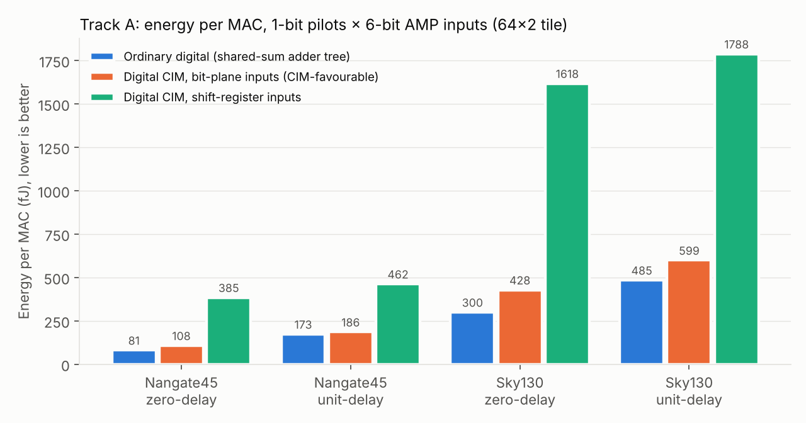
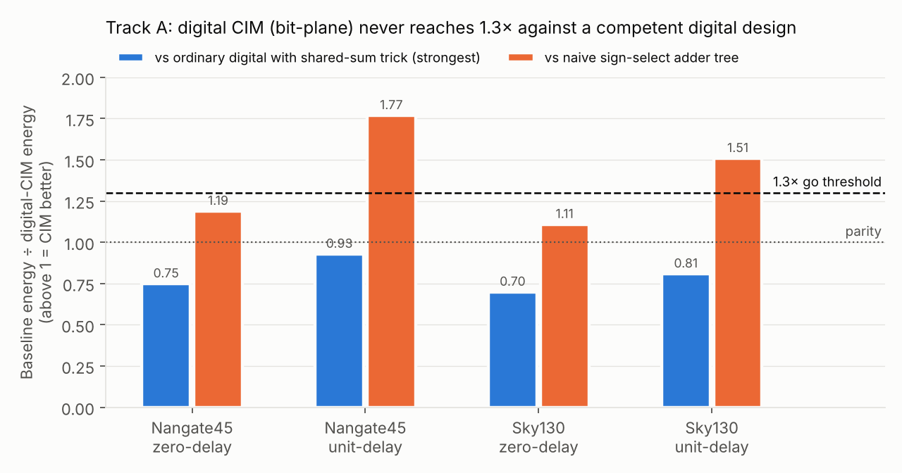
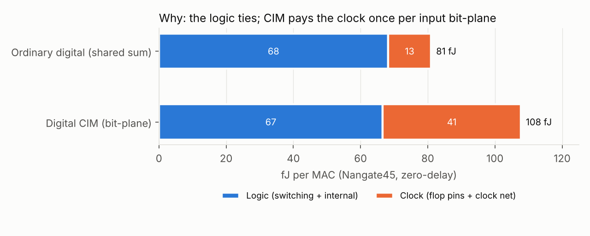
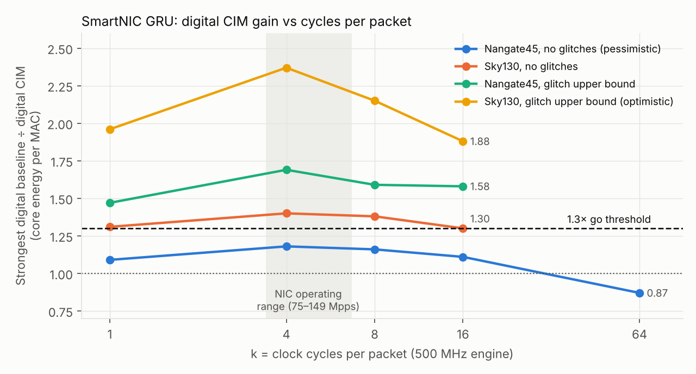
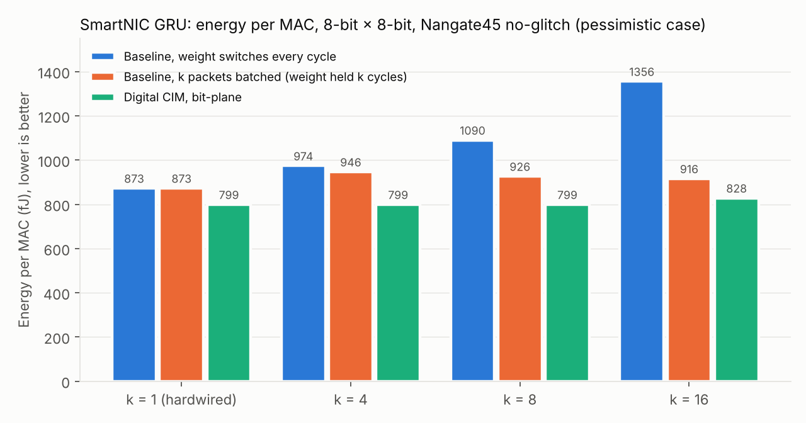
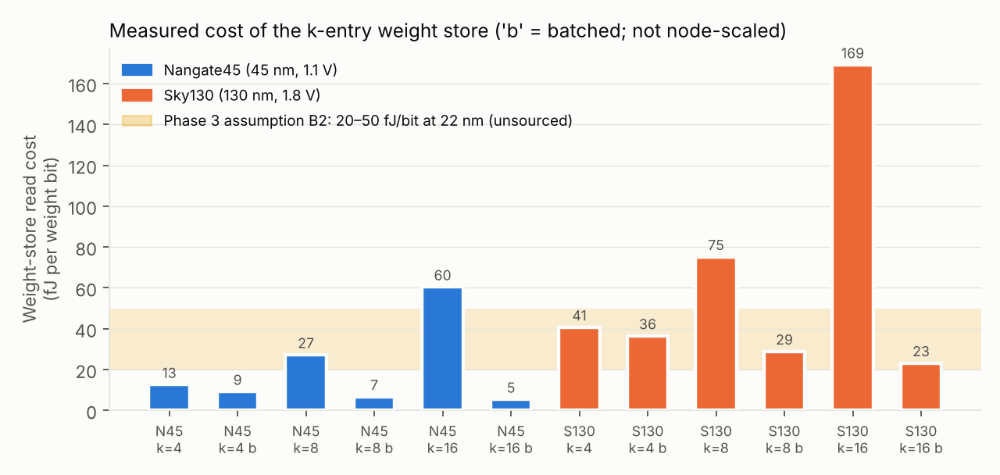
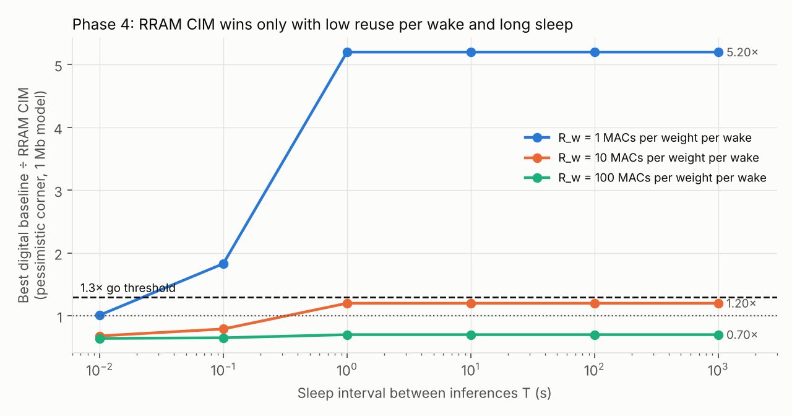

# NYCU: where does compute-in-memory actually win?

Research code and results from my NYCU internship on SRAM and RRAM compute-in-memory (CIM). The question throughout is narrow and skeptical: **for a given workload, does CIM beat the strongest conventional digital design at equal throughput and precision, by at least 1.3× at the pessimistic corner?**

Everything here is simulation, RTL and synthesis. No fabrication.

## Contents

| Folder | What it is | Verdict |
|---|---|---|
| [`trackA_phase3/`](trackA_phase3/) | Grant-free activity detection (AMP, ±1 pilots): digital CIM vs ordinary digital logic. RTL, Yosys synthesis on Nangate45 and Sky130, gate-level power on real AMP traces | **NO-GO**: 0.70–0.93× |
| [`smartnic_A2/`](smartnic_A2/) | Per-packet GRU intrusion detector on a SmartNIC: digital CIM vs an adder-tree array with a k-entry weight store per multiplier (k = 1–64), batched and unbatched, Nangate45 and Sky130 | **NO-GO**: 1.11× pessimistic, 2.18× optimistic |
| [`phase4/`](phase4/) | Four-axis screen of 29 workloads for SRAM / RRAM CIM (energy, non-volatility, density, analog matrix computing) | **NO-GO** for all candidates; yields an RRAM reuse-per-wake criterion |
| [`docs/Exploration_log.md`](docs/Exploration_log.md) | Every workload tried so far (24 entries), its baseline, numbers and deciding gate | — |
| [`tools/make_figures.py`](tools/make_figures.py) | Regenerates every figure below from the committed JSON | — |

## Headline results

### Track A: grant-free activity detection on digital CIM

With 1-bit pilot weights, a competent digital design (shared-sum adder tree) beats digital CIM in every library and glitch case.





The arithmetic logic costs the same on both sides. CIM loses because it clocks its accumulator once per input bit-plane.



| Baseline ÷ digital CIM (bit-plane) | Nangate45 zero-delay | Nangate45 unit-delay | Sky130 zero-delay | Sky130 unit-delay |
|---|---|---|---|---|
| Strongest digital (shared-sum adder tree) | 0.75 | 0.93 | 0.70 | 0.81 |
| Naive sign-select adder tree | 1.19 | 1.77 | 1.11 | 1.51 |

Above 1 means CIM is better. The go threshold was 1.3. Details: [`trackA_phase3/REPORT.md`](trackA_phase3/REPORT.md).

### SmartNIC per-packet GRU on digital CIM

At NIC packet rates (75–149 Mpps) each multiplier serves only 4–8 weights. Against the strongest digital design (a small weight store per multiplier, packets of independent flows batched), digital CIM gains 1.16–1.18× without glitches and up to 2.37× at the glitch upper bound. With common overheads that is 1.11–2.18× at system level, which saves at most 0.2% of NIC power at the pessimistic corner.





The weight store that earlier screens assumed at 20–50 fJ/bit measures 7–27 fJ/bit at 45 nm, so most of CIM's remaining edge is in the datapath, not in avoided weight movement.



Details: [`smartnic_A2/REPORT.md`](smartnic_A2/REPORT.md).

### Phase 4: RRAM reuse-per-wake criterion

Against the strongest digital baselines (SRAM kept in retention, MRAM read directly, or MRAM copied to SRAM at wake), RRAM CIM clears 1.3× at the pessimistic corner only when each weight is used at most about 8 times per wake and the device sleeps at least about 0.04 s between inferences (1 Mb model).



Inside that region the gain is 5.2× (pessimistic) to 87× (optimistic), but the applications that sit there (keyword spotting, battery-free inference, vibration and ECG monitoring) already have published CIM chips. Details: [`phase4/REPORT.md`](phase4/REPORT.md).

## Reproducing

Python 3.10+, `numpy`, `matplotlib`, `liberty-parser`; Yosys 0.33 and Icarus Verilog 12 for the synthesis flow. See [`trackA_phase3/README.md`](trackA_phase3/README.md) for the step-by-step flow and the liberty files to download.

```bash
pip install numpy matplotlib liberty-parser
python phase4/screen_phase4_axes.py          # Phase 4 energy screen -> phase4/screen_phase4_axes.json
python tools/make_figures.py                 # all figures, from the committed JSON
```

## Evidence labels used in the reports

- **[S]** our synthesis and gate-level simulation
- **[P]** our arithmetic on those numbers
- **[M]** measured or stated in a cited paper
- **[A]** assumed

Numbers taken from papers were read from abstracts and secondary pages; check the original tables before citing them.
