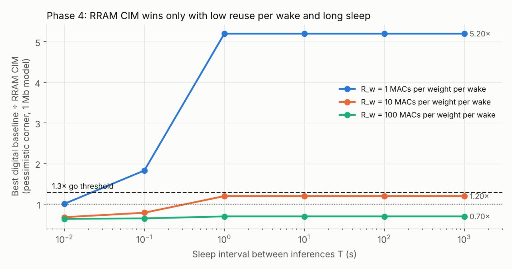

# Phase 4: four-axis screen for new SRAM / RRAM CIM application spaces

29 workloads screened across four ways CIM could win: energy (low weight reuse), non-volatility (RRAM, duty-cycled devices), density (models too big for SRAM) and analog matrix computing (one-step linear solves). Three passed the prefilter and were gated in full; all three are NO-GO. Full write-up, long list, gate tables and sources: [`REPORT.md`](REPORT.md).



## Files

| File | Purpose |
|---|---|
| `screen_phase4_axes.py` | Energy model for all four axes (reuses the Phase 3 constants) |
| `screen_phase4_axes.json` | Its output: axis-2 sweep and hosts, continuous wearable case, FrodoKEM, Classic McEliece, analog-solver crossover, edge small-LM decode |
| `REPORT.md` | Long list, short list, gate tables, novelty audit, sources |

```bash
python screen_phase4_axes.py      # writes screen_phase4_axes.json next to the script
```

Several inputs are assumptions and are labelled [A] in the report: LPDDR energy, RRAM-CIM density, wake-up overhead and per-wake host energy.
