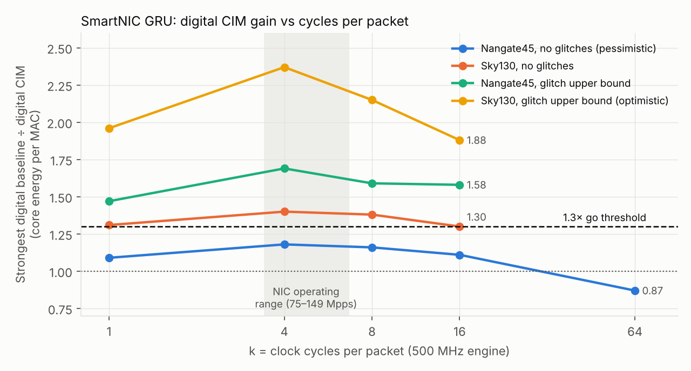
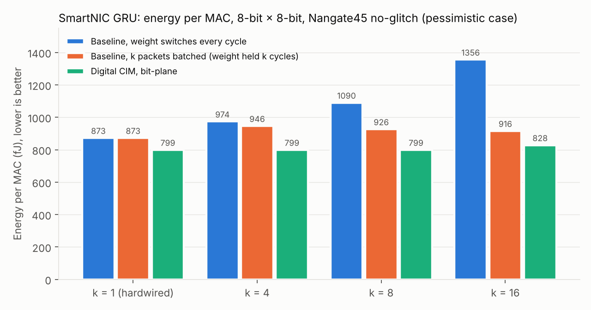
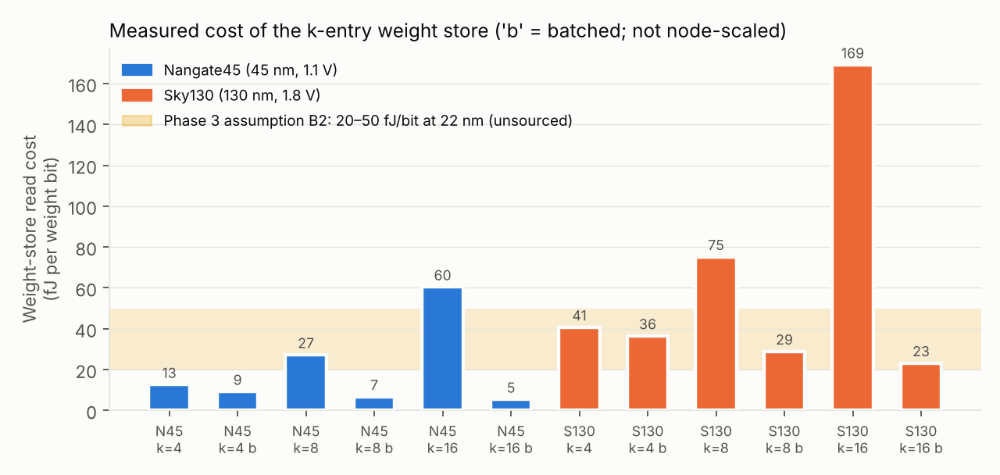

# SmartNIC per-packet GRU: digital CIM vs a weight-store digital array

Per-packet GRU intrusion detector (input 16, hidden 64, 8-bit × 8-bit) on a 500 MHz SmartNIC engine. At 75–149 Mpps each multiplier serves k = 3.4–6.7 weights per packet, so the digital baseline needs a small weight store beside each multiplier. This test synthesises that store instead of assuming its energy.

**Result: NO-GO.** System ratio 1.11× at the pessimistic corner (below the 1.3× rule), 2.18× at the optimistic one; at most 0.2% of NIC power saved at the pessimistic corner. Full write-up: [`REPORT.md`](REPORT.md).





## Files

| File | Purpose |
|---|---|
| `train_proxy_gru.py` | Trains the GRU in JAX on synthetic per-packet flows, quantises to int8, records the per-packet operands → `data/nic_traces.npz` |
| `gen_rtl_nic.py` | Verilog: `ws_k{K}` (k-entry store per multiplier), `wsb_k{K}` (Booth variant), `dcim_g{G}` (digital CIM, bit-plane) |
| `syn.sh`, `syn_abcfast.sh`, `syn_all.sh` | Yosys scripts; `syn_abcfast.sh` (ABC `-fast`) is the one used, calibrated against the kill-test script |
| `gsim.py` | Gate-level simulator and liberty power model (unchanged from the kill test) |
| `run_power_nic.py` | Gate-level power on the traces, bit-exact output check, latency search; `batch` mode for the batched baseline, `TRACE=gauss` for the sensitivity run |
| `analyze_nic.py` | Tables, ratios, store cost, area, NIC share → `results/summary_nic.json` |
| `make_figures_nic.py` | The three figures |

## Running

```bash
pip install numpy jax matplotlib liberty-parser      # plus Yosys 0.33
mkdir -p lib syn
# liberty files: see ../trackA_phase3/README.md
python train_proxy_gru.py
python gen_rtl_nic.py 64 2 rtl
./syn_all.sh n45 ws_k1 ws_k4 ws_k8 ws_k16 ws_k64 wsb_k1 dcim_g1 dcim_g2 dcim_g8
./syn_all.sh s130 ws_k1 ws_k4 ws_k8 ws_k16 dcim_g1 dcim_g2 dcim_g8
python run_power_nic.py n45 512                                    # zero-delay, all designs
python run_power_nic.py n45 512 x ws_k4,ws_k8,ws_k16,ws_k64 batch  # batched baseline
python run_power_nic.py n45 256 glitch ws_k1,ws_k4,ws_k8,ws_k16,dcim_g1,dcim_g2
python analyze_nic.py && python make_figures_nic.py figures
```

The packet-level datasets (CIC-IDS2017 / UNSW-NB15 packet subsets) were not reachable from the session, so accuracy (G5) is not evaluated; the synthetic task only supplies switching statistics.
