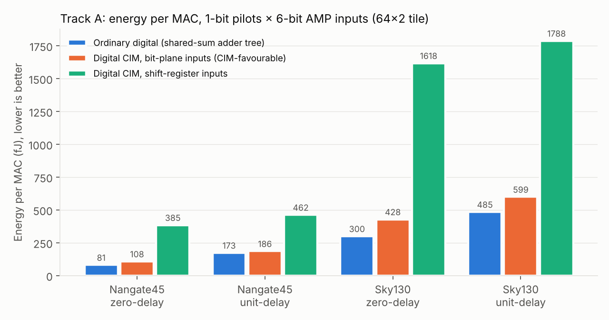
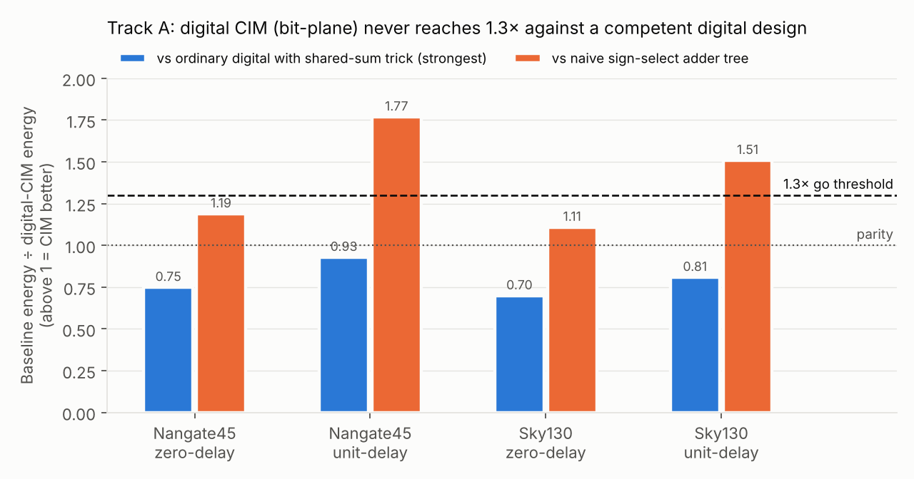
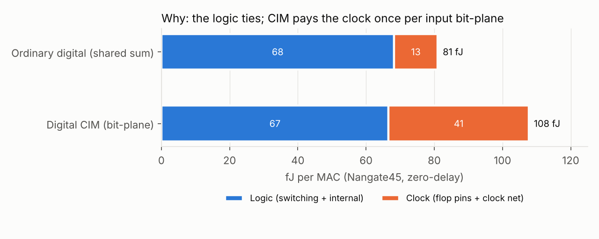

# Track A, Phase 3: digital CIM vs ordinary digital logic (1-bit weights)

Grant-free activity detection with AMP: 2048 registered devices, 128-symbol QPSK pilots, 64 antennas. The pilot matrix [Sr; Si] (256 × 2048, ±1 entries) is the stored weight matrix; the AMP residuals, quantised to 6 bits, are the inputs.

**Result: digital CIM is 0.70–0.93× the energy efficiency of a competent digital design. Track A is closed.** Full write-up: [`REPORT.md`](REPORT.md).





## Designs (64-row × 2-column tile)

| Design | Description |
|---|---|
| `sgn_tree`, `sgn_tree_ni` | Each row adds +x or −x, balanced adder tree, output register (`_ni`: no input registers) |
| `and_tree_ni` | Strongest baseline: Σ s·x = 2·Σ_{s=+1} x − Σ x, so each leaf is "x or 0"; Σ x is shared by all 2048 columns |
| `dcim` | Digital CIM column: per-row shift register, input bit AND weight bit, popcount tree, shift-accumulate over 6 bit-planes |
| `dcim_bp` | As `dcim`, bit-planes straight from a bit-transposed buffer (most favourable to CIM) |
| `dcim_sm_bp` | Sign-magnitude inputs (5 magnitude planes + sign) |

RTL for 64 and 256 rows is in [`rtl/`](rtl/).

## Files

| File | Purpose |
|---|---|
| `extract_trackA_traces.py` | Runs the Track A AMP detector and records the 6-bit correlator inputs and pilot bits → `data/trackA_traces.npz` |
| `gen_rtl_1b.py` | Generates the Verilog cores |
| `rtl_check_1b.py` | Icarus RTL check, bit-exact against numpy |
| `syn.sh` | Yosys synthesis script (`synth`, `abc -D 2000`, liberty mapping) |
| `gsim.py` | Gate-level simulator and liberty power model (unchanged from the Phase 1 kill test) |
| `run_power_1b.py` | Simulates each synthesised netlist on the traces, checks every output bit-exactly, reports fJ/MAC |
| `summarize_1b.py` | Builds `results/summary_1b.json` (tables and ratios) |
| `results/` | Raw power results per library and glitch model, plus the summary |

## Running the flow

The AMP simulator (`detectors.py`, `sram_cim_sim.py`) is from Track A Phase 2 and is not in this repository; `data/trackA_traces.npz` is committed so the flow below runs without it.

```bash
# toolchain: Yosys 0.33, Icarus Verilog 12, Python with numpy and liberty-parser
cd trackA_phase3
mkdir -p lib syn sim
curl -L -o lib/nangate45.lib https://raw.githubusercontent.com/The-OpenROAD-Project/OpenROAD-flow-scripts/master/flow/platforms/nangate45/lib/NangateOpenCellLibrary_typical.lib
curl -L -o lib/sky130_hd_tt.lib https://raw.githubusercontent.com/The-OpenROAD-Project/OpenROAD-flow-scripts/master/flow/platforms/sky130hd/lib/sky130_fd_sc_hd__tt_025C_1v80.lib

python gen_rtl_1b.py 64 2 rtl
python rtl_check_1b.py 64 2                       # expect "ALL OK"
for d in sgn_tree sgn_tree_ni and_tree_ni dcim dcim_bp dcim_sm_bp; do
  bash syn.sh $d 64 2 lib/nangate45.lib n45
  bash syn.sh $d 64 2 lib/sky130_hd_tt.lib s130
done
python run_power_1b.py n45 256                    # zero-delay
python run_power_1b.py n45 128 glitch             # unit-delay glitch bound
python run_power_1b.py s130 256
python run_power_1b.py s130 128 glitch
python summarize_1b.py
```

Toolchain check: the same flow reproduces the Phase 1 kill-test baseline (`ws_tree_ni`, Nangate45) exactly: 339.58 fJ/MAC, 43,870 cells.

## Limitations

45 nm and 130 nm standard cells, wire-load model, no place and route, X1 cells, no clock gating. Custom CIM circuits could be cheaper than standard cells, but they would need to beat an equally custom digital tree by at least 1.3×. Even with CIM's clock energy set to zero the ratio is only 1.20–1.42×.
